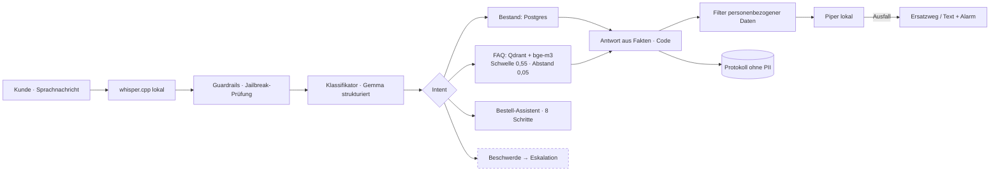

# Architektur / Architecture

| Workflow | Aufgabe / Purpose | Trigger |
|---|---|---|
| `P14_VoiceDesk_Full-local` | Sprachdialog, Bestand, FAQ, Bestellung / voice dialogue | Telegram |
| `P14_Ingestion_FAQ-to-Qdrant` | FAQ-PDF → Qdrant | manuell / Formular |
| `P14_Watchdog` | prüft alle 10 min STT, Modell, Suche, TTS / health check | Zeitplan, Error |
